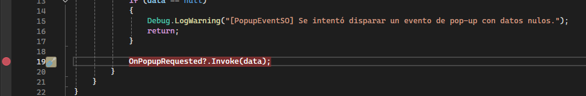

# Análisis del Flujo de Juego y Depuración en Tiempo de Ejecución

**Evento Analizado:** `PopupEventSO.OnPopupRequested` (`System.Action<PopupData>`)  
**Componentes Intervinientes:** `PlayerHealth.cs`, `PopupEventSO.cs`, `PopupManager.cs`, `GenericPopupView.cs`

---

### Dinámica de Juego y Recorrido de la Experiencia en Tiempo Real

Durante una partida activa en la arena de *ByteCollector*, el flujo de interrupción y presentación de interfaz ante la derrota del avatar sigue una secuencia directa y desacoplada:

1. **Detección de Impacto en la Arena:**  
   Al colisionar el avatar (`Byte_Player`) contra una amenaza del entorno (`Glitch_Leak` / `CorruptedTile`), la salud se descuenta progresivamente. Al agotarse las 3 vidas, el script de salud bloquea inmediatamente las entradas de control y detiene el movimiento del personaje para evitar desplazamientos inerciales.

2. **Despacho del Alerta Desacoplado:**  
   En lugar de abrir una interfaz de forma directa y rígida, el sistema de gameplay emite una solicitud mediante el canal `PopupEventSO`. Este mensaje empaqueta la información del modal (título `"SISTEMA COLAPSADO"`, mensaje de confirmación) junto con las acciones concretas asociadas a los botones (*Reintentar Nivel* / *Volver al Menú*).

3. **Interrupción y Congelamiento del Tiempo:**  
   El gestor de interfaz (`PopupManager`) recibe la orden de forma autónoma. De inmediato, fuerza la congelación total del bucle de simulación del juego (`Time.timeScale = 0f`), deteniendo el avance de los proyectiles y la animación de los enemigos en la arena.

4. **Despliegue del Modal sobre la Pantalla:**  
   La ventana emergente genérica (`GenericPopupView`) se ubica al frente de la jerarquía visual del Canvas, bloqueando las interacciones de fondo y mostrando los botones de acción para que el jugador elija cómo continuar.

---

### Evidencia Audiovisual de Depuración y Jugabilidad

* **Video Demostrativo del Flujo (Step Into - F11):**  
  **[Enlace al Video de Depuración](../Imagenes/Debug/debugger_stepinto_demo.mp4)**
  Muestra la sesión de depuración acoplada al editor de Unity (*Attach to Unity Process*), evidenciando cómo al colisionar el avatar, la ejecución se detiene en el emisor y avanza limpiamente paso a paso mediante la tecla **F11** hacia el gestor de UI, mientras en la ventana de juego se aprecia el congelamiento de la pantalla y la apertura del modal.

* **Captura en Play Mode (Juego Pausado):**  
    
  *Figura 1: Vista en tiempo de ejecución del modal desplegado sobre la arena de juego pausada.*

---

## Resumen Sintético de la Actividad

1. **Nombre del Evento Analizado:** `PopupEventSO.OnPopupRequested` (`System.Action<PopupData>`).
2. **Clases y Scripts Involucrados:** `PlayerHealth.cs` (emisor de gameplay), `PopupEventSO.cs` (canal Observer), `PopupManager.cs` (controlador de la UI), `GenericPopupView.cs` (vista modal) e `ICommand` (`RestartLevelCommand` / `ReturnToMenuCommand`).
3. **Orden de Ejecución Observado:** Colisión en arena ➔ Descuento de salud ➔ Disparo de `TriggerGameOver()` ➔ Invocación en `PopupEventSO.Raise()` ➔ Recepción en `PopupManager.ShowPopup()` ➔ Congelamiento del tiempo (`Time.timeScale = 0f`) ➔ Despliegue de `GenericPopupView`.
4. **Problemas y Anomalías Detectadas:** No se observaron ejecuciones duplicadas del evento ni caídas de frames al pausar el juego. Al utilizar métodos nombrados para suscribirse al canal, la navegación en el depurador con **Step Into (F11)** fue directa y fluida, confirmando que no hay comportamientos anómalos ni listeners perdidos en la escena.
5. **Posibles Mejoras y Ajustes Propuestos:** Asegurar la desuscripción explícita (`-=`) en el ciclo `OnDisable` de todos los elementos de UI para prevenir referencias colgadas en memoria al cambiar de nivel, e incorporar un canal de métricas para registrar la causa de la derrota del jugador.
